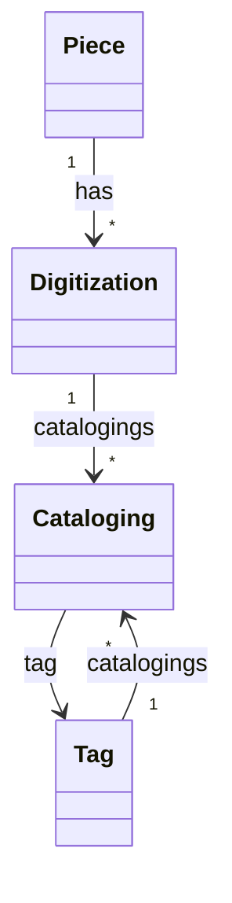

# ARCHITECTURE.md

Documento transversal (no cambia por feature/iteración). Complementa a `AGENTS.md`
(convenciones de código) con la descripción del dominio y la arquitectura general del sistema.

## 1. Descripción general

Monolito Spring Boot (Java 21 + H2) que gestiona un archivo digital: alta de piezas
físicas, digitalización (URLs asociadas a una pieza), catalogación (tags sobre las
digitalizaciones) y búsqueda/disponibilización del material. La API es HTTP/JSON
(sin pantallas); la visualización se hará vía bot de Telegram.

## 2. Actores y sistemas

- **Administrador** — gestiona el conjunto de tags (alta, activar/desactivar) y
  cataloga digitalizaciones.
- **Usuario / Bot de Telegram** — busca piezas por fecha, nombre, descripción y tags.
- **Sistema externo (futuro)** — servicios de OCR/etiquetado (extra del TP).

## 3. Alcance y fuera de alcance

**Dentro de alcance:**
- Digitalización: alta de piezas y asociación de digitalizaciones (URL + descripción).
- Catalogación: asociar tags (de un conjunto administrable) a digitalizaciones.
- Disponibilizació: búsquedas por fecha, nombre, descripción y tags sobre **piezas**.
- Visualización: bot de Telegram para buscar y mostrar resultados.

**Fuera de alcance:**
- Pantallas / frontend web.
- Procesamiento real de imágenes (OCR) salvo extra.

## 4. Glosario de dominio

| Término | Significado |
|---|---|
| Pieza (`Piece`) | Material físico del archivo (nombre, descripción, fecha). |
| Digitalización (`Digitization`) | URL con un recurso digitalizado y descripción; pertenece a una pieza. |
| Tag (`Tag`) | Etiqueta administrable (activa/inactiva) seleccionada de un conjunto fijo. |
| Catalogación (`Cataloging`) | Asociación única entre una digitalización y un tag (entidad intermedia). |

> Todo el código va en inglés (AGENTS.md): `Piece`, `Digitization`, `Tag`, `Cataloging`
> / tabla `catalogings`. En la documentación en español se usa "catalogación" como
> término de dominio.

## 5. Vista C4 — Contexto (Nivel 1)

```mermaid
C4Context
    title Contexto del sistema
    Person(admin, "Administrador", "Gestiona tags y cataloga digitalizaciones")
    Person(user, "Usuario", "Busca piezas vía bot de Telegram")
    System(archivo, "Archivo Digital", "Gestiona piezas, digitalizaciones, tags y búsquedas")
    System_Bot(telegram, "Bot de Telegram", "Interfaz de búsqueda")
    admin --> archivo
    user --> telegram
    telegram --> archivo
```

## 6. Vista C4 — Contenedores (Nivel 2)

```mermaid
C4Container
    title Contenedores
    Container(api, "API Web", "Spring Boot MVC", "Endpoints REST de digitalización, catalogación y búsqueda")
    Container(db, "Base de datos", "H2", "pieces, digitizations, tags, catalogings")
    Container(bot, "Bot de Telegram", "Spring", "Consultas de búsqueda")
    api --> db
    bot --> api
```

## 7. Diagrama de clases de dominio

Ver [`docs/diagrams/domain-class-diagram.md`](docs/diagrams/domain-class-diagram.md).



Diagrama de BD: [`docs/diagrams/database-diagram.md`](docs/diagrams/database-diagram.md).
Secuencia de catalogación: [`docs/diagrams/sequence-cataloging.md`](docs/diagrams/sequence-cataloging.md).

## 8. Preguntas abiertas / próximos pasos

- Endpoints de alta de `Piece` / `Digitization` (parte de digitalización).
- Disponibilización: búsquedas sobre piezas por fecha, nombre, descripción y tags.
- Bot de Telegram (visualización).
- `test.md` con la secuencia de uso completa del sistema.

## 9. Referencias

- Convenciones de código: [`AGENTS.md`](AGENTS.md).
- Especificación de la API: [`docs/api.md`](docs/api.md).
