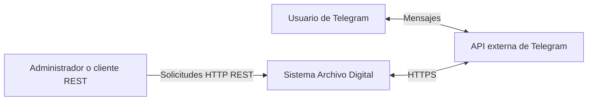
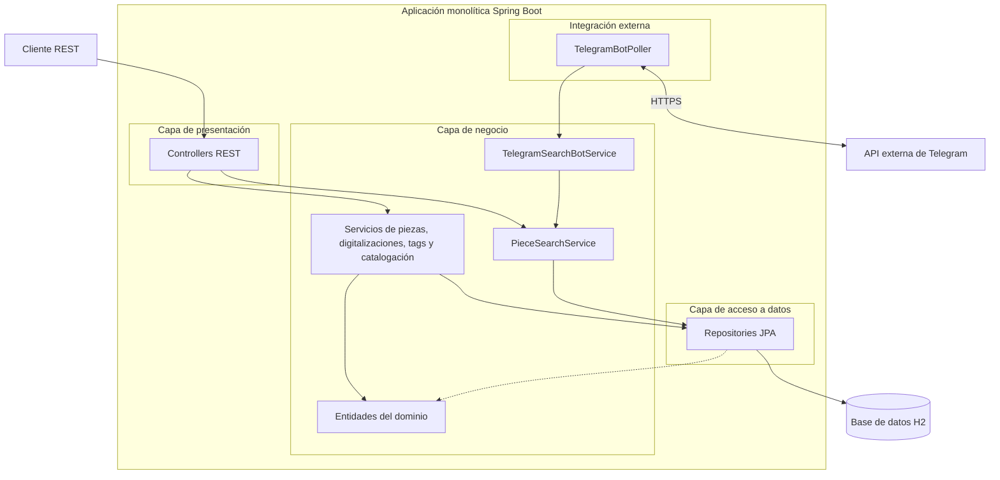

# Diagramas de arquitectura — Archivo Digital

## 1. Diagrama de contexto

El sistema permite registrar piezas, digitalizaciones,
administrar tags, realizar catalogaciones y buscar piezas.

Los usuarios también pueden realizar búsquedas mediante
el bot de Telegram.

## 2. Diagrama de arquitectura interna

## 3. Decisiones de arquitectura

- Se utiliza una arquitectura monolítica con una única
  aplicación Spring Boot y una única base de datos.
- La aplicación se organiza en capas, separando presentación,
  negocio y acceso a datos.
- Los controllers reciben solicitudes HTTP y delegan
  las operaciones a los servicios.
- Los servicios coordinan los casos de uso y aplican
  las reglas correspondientes junto con el modelo.
- Los repositorios gestionan la persistencia mediante JPA.
- Los DTOs permiten intercambiar datos sin exponer
  directamente las entidades del dominio.
- El bot de Telegram forma parte del mismo monolito.
- TelegramSearchBotService reutiliza PieceSearchService
  sin realizar solicitudes HTTP a la propia API REST.
- H2 funciona en memoria en el perfil local.
- La API de Telegram es una dependencia externa,
  no un componente independiente desarrollado por el equipo.