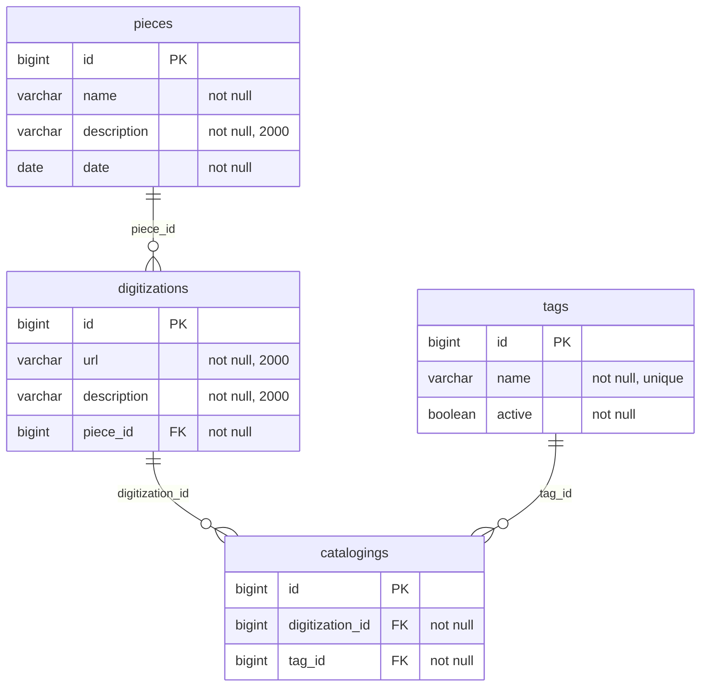

# Diagrama de base de datos

Tablas generadas por JPA (perfil `local`, H2 con `ddl-auto=create-drop`).

## Restricciones

- `catalogings`: unique compuesto `(digitization_id, tag_id)` — una sola asociación
  por par digitalización/tag (entidad intermedia de catalogación).
- `tags.name`: unique.
- FKs NOT NULL en `digitizations.piece_id`, `catalogings.digitization_id`,
  `catalogings.tag_id`.
