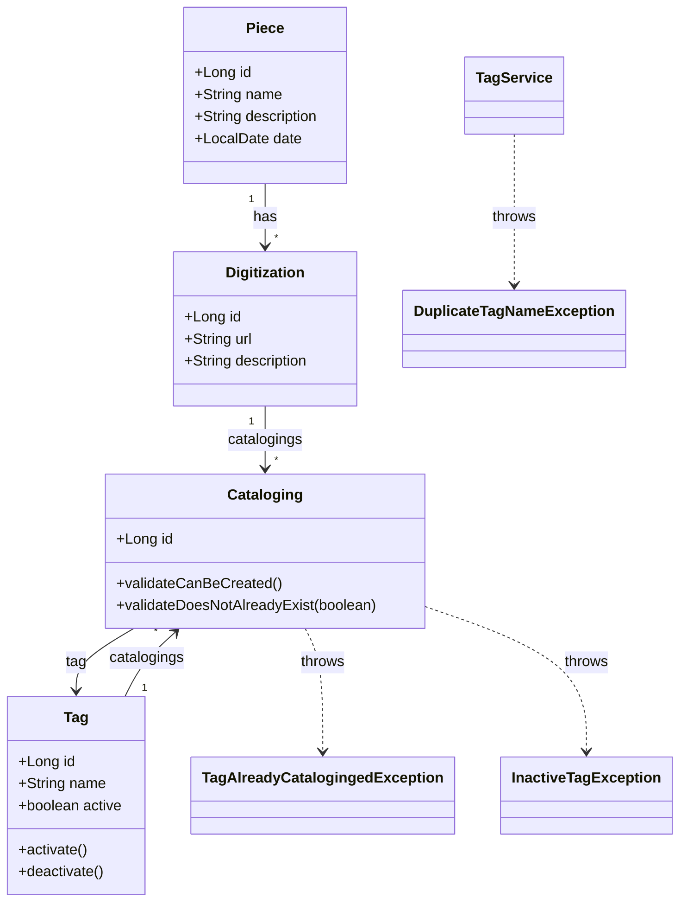

# Diagrama de clases de dominio

Capa: `model`.

## Relaciones

- Una `Piece` tiene muchas `Digitization` (1..*).
- Una `Digitization` tiene muchas `Cataloging` (1..*).
- Un `Tag` participa en muchas `Cataloging` (1..*).
- `Cataloging` es la entidad asociativa (única por par digitalización + tag).
  En español: catalogación.
