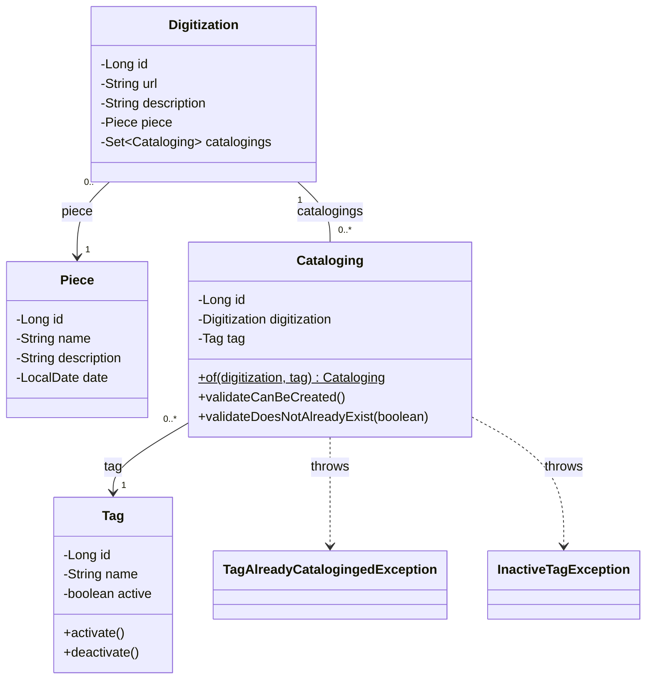

# Diagrama de clases de dominio

Capa: `model`.

## Relaciones

- Una `Piece` puede tener cero o muchas digitalizaciones.
- Cada `Digitization` pertenece a una única pieza.
- Una `Digitization` puede tener cero o muchas catalogaciones.
- Cada `Cataloging` pertenece a una única digitalización
  y referencia un único tag.
- Un `Tag` puede participar en cero o muchas catalogaciones.
- `Cataloging` es la entidad asociativa entre una
  digitalización y un tag.

## Reglas de dominio

- No se puede catalogar una digitalización con un tag inactivo.
- No se puede repetir una asociación entre una digitalización
  y un mismo tag.
- Desactivar un tag no elimina las catalogaciones existentes.
- Los tags pueden activarse y desactivarse.

Los getters, setters y constructores generados mediante
Lombok se omiten del diagrama para facilitar su lectura.