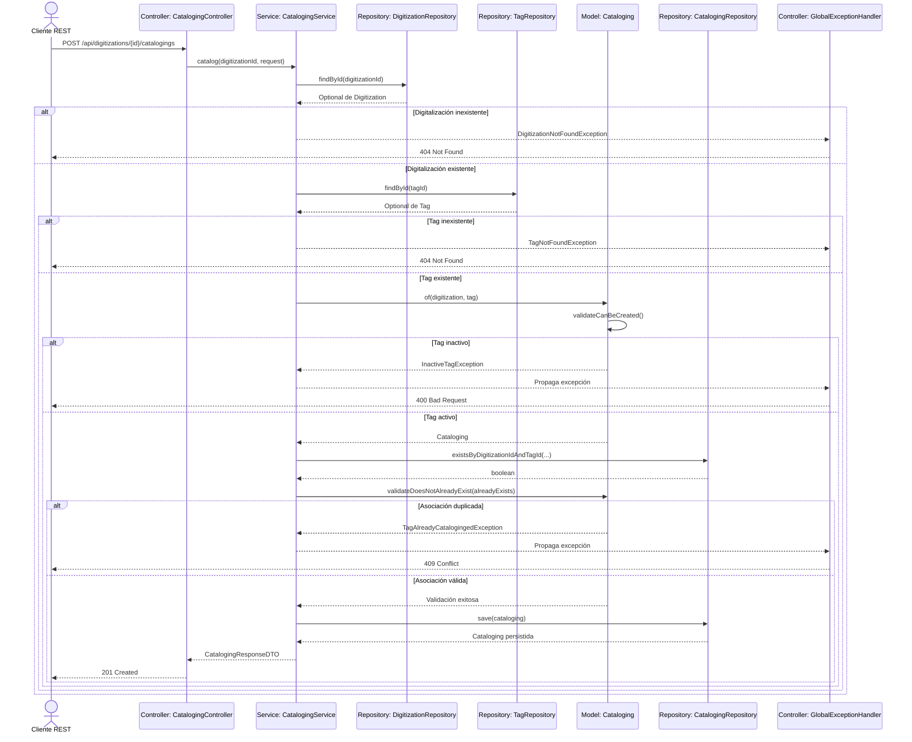

# Diagrama de secuencia — Asociar tag a una digitalización

Flujo: `POST /api/digitizations/{id}/catalogings`.

Cuerpo de la solicitud: `{ "tagId": 1 }`.

Capas: Controller, Service, Repository y Model.

## Responsabilidades

- Controller: recibe la solicitud y devuelve la respuesta HTTP.
- Service: coordina la operación dentro de una transacción.
- Repository: consulta y persiste las entidades.
- Model: valida las reglas de negocio de la catalogación.
- GlobalExceptionHandler: traduce las excepciones a
  respuestas HTTP mediante Spring MVC.

Las flechas hacia GlobalExceptionHandler representan el
manejo de excepciones realizado por Spring MVC, no
invocaciones directas desde el servicio.