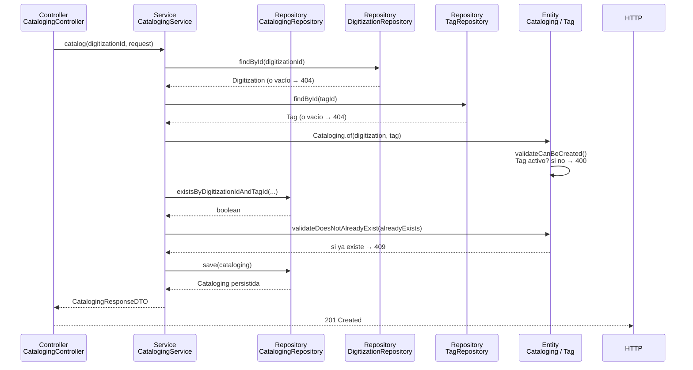

# Diagrama de secuencia — Asociar tag a una digitalización

Flujo: `POST /api/digitizations/{id}/catalogings` con `{ "tagId": 1 }`.

Capas (Fowler): Controller → Service → Repository → Entity (model).

