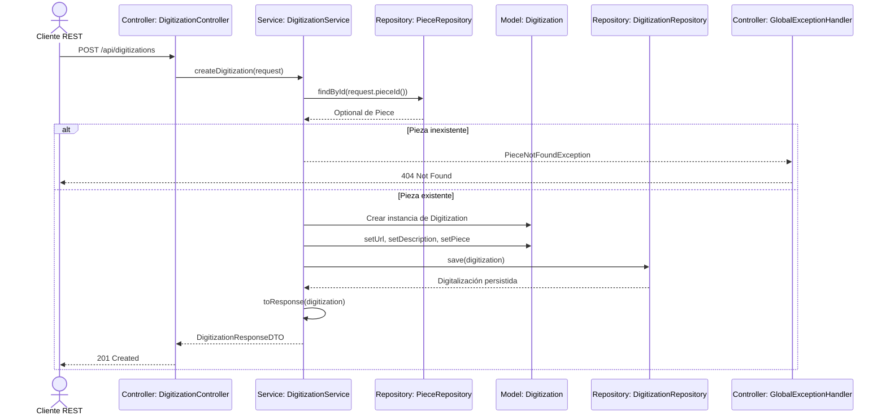

# Diagrama de secuencia — Crear una digitalización

Flujo: `POST /api/digitizations`.

## Responsabilidades

- Controller: recibe y valida la solicitud HTTP.
- Service: verifica la existencia de la pieza y coordina
  la creación de la digitalización.
- Model: representa la digitalización y su relación
  con la pieza física.
- Repository: consulta y persiste las entidades.
- GlobalExceptionHandler: traduce las excepciones
  a respuestas HTTP mediante Spring MVC.

No se puede crear una digitalización asociada a una
pieza inexistente.

La operación se ejecuta dentro de una transacción.

El manejo de excepciones es realizado por Spring MVC,
no mediante una llamada directa al GlobalExceptionHandler.