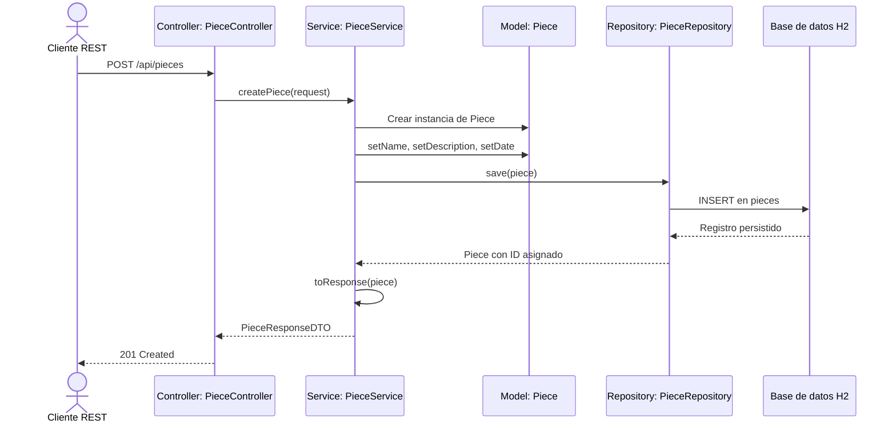

# Diagrama de secuencia — Crear una pieza

Flujo: `POST /api/pieces`.

## Responsabilidades

- Controller: recibe y valida la solicitud HTTP.
- Service: coordina la creación de la pieza.
- Model: representa la entidad del dominio.
- Repository: gestiona la persistencia mediante JPA.

La operación de creación se ejecuta dentro de una
transacción mediante `@Transactional`.

El diagrama representa el flujo exitoso.