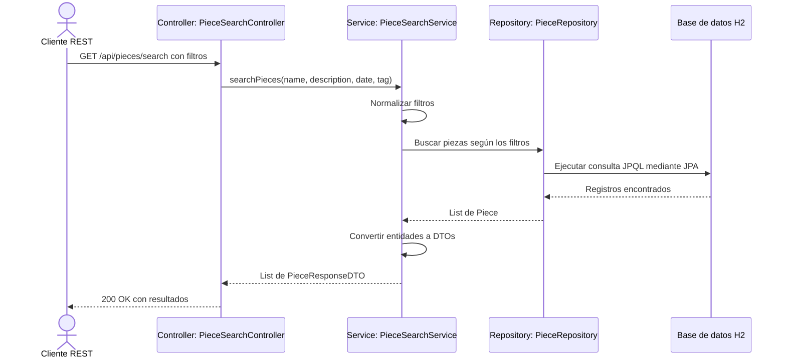

# Diagrama de secuencia — Búsqueda de piezas

Flujo: `GET /api/pieces/search`.

Filtros opcionales: nombre, descripción, fecha y tag.

## Consideraciones

- Los filtros son opcionales y pueden combinarse.
- La búsqueda se realiza sobre las piezas físicas.
- Los filtros se aplican mediante consultas a la base de datos.
- Se utiliza DISTINCT para evitar piezas duplicadas.
- Si no existen coincidencias, se devuelve una lista vacía.
- Actualmente no se utiliza paginación.