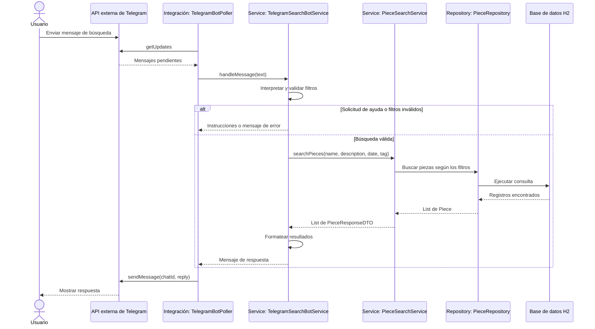

# Diagrama de secuencia — Búsqueda mediante Telegram

El bot reutiliza el servicio de búsqueda de la aplicación
sin realizar solicitudes HTTP a nuestra propia API REST.

## Consideraciones

- TelegramBotPoller consulta periódicamente la API de Telegram.
- TelegramSearchBotService interpreta los mensajes y filtros.
- PieceSearchService reutiliza la misma lógica de búsqueda
  utilizada por la API REST.
- Las respuestas respetan el límite de 4096 caracteres.
- El token se configura externamente y no se almacena
  en el repositorio.
- El bot forma parte de la misma aplicación monolítica.